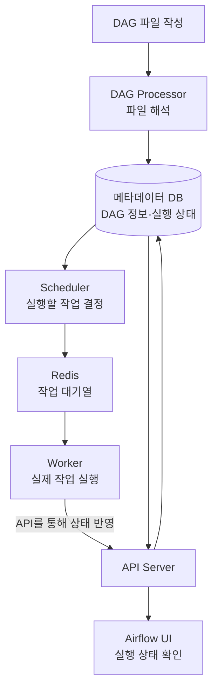

# airflow DAG 기본구조

학습일: 2026-11-03
강의: [DE 필수 도구, Apache Airflow 이론 30분만에 총 정리합니다!(개념부터 아키텍처까지)]
      [영상 링크: https://www.youtube.com/watch?v=uEJ8pAiGKzQ&t=77s]
실습 상태: 개념 학습 중, 아직 실행하지 않음

## 1. 오늘 배운 내용

- **DAG**
    - 일방향적 이며 자신으로 되돌아오는 경로가 없는 그래프
    - 작업의 실행 순서 보장과 무한 루프 방지 등을 위해 완료된 작업을 다시 호출할 수 없도록 강제함
    - Airflow에서 하나의 온전한 파이프라인 작업 스크립트를 DAG라 칭함

    ```mermaid
    flowchart LR
        t1["1"] --> t2["2"]
        t1 --> t3["3"]
        t2 --> t4["4"]
        t3 --> t5["5"]
        t4 --> t6["6"]
        t5 --> t6
        t5 --> t7["7"]
        t7 --> t8["8"]
     ```

- **Operator** 
    - 어떤 작업(Task)을 수행할지 정의함
    - 거의 모든 배치성 ETL작업 수행 가능
    - BaseOperator class 상속 받아 사용자 정의 오퍼레이터 생성 가능
    
    ```mermaid
    flowchart LR
    a["a · EmptyOperator"] --> b["b · EmptyOperator"]
    a --> c["c · EmptyOperator"]
    b --> d["d · EmptyOperator"]
    c --> d
    ```

- **XCom(cross communication)**
    - Task간 데이터나 리턴값 등 이전 작업의 output을 다음 작업에 전달하기 위한 매커니즘
    - 동일 DAG 파이프라인 안에서만 데이터 공유 가능
    - 소규모 데이터를 공유하도록 설계(약 10MB)
    - xcom_push(), xcom_pull() 활용
    - PythonOperator 반환 값은 자동으로 XCom에 저장

    ```mermaid
    flowchart LR
    t1["Task 1 · PythonOperator"] --> t2["Task 2 · PythonOperator"]
    t2 --> t3["Task 3 · PythonOperator"]

    t1 -.->|"push"| x1["XCom: 값 1"]
    x1 -.->|"pull"| t2
    t2 -.->|"push"| x2["XCom: 값 2"]
    x2 -.->|"pull"| t3
    ```

- **Sensor**
    - 조건 충족할때 까지 기다리는 Operator
    - python, sql, http 등 다양함
    - BaseSensor Operator Class를 상속 받아 사용자 정의 센서 개발 가능

- **Connection**
    - 외부 서비스와 통신하기 위한 URL, (ID, PASSWORD)를 저장하는 설정
    - HOOK에서 Connection 정보 활용하여 수행 

- **Hook**
    - Operator에서 Connection 정보를 받아 python 객체로 생성하게 도와주는 기능
    - BaseHook Class로 외부 시스템과 커스텀한 연결 생성 가능

    ```mermaid
    flowchart TD
    DAG["DAG · 전체 워크플로우"]
    OP["Operator · 작업 정의"]

    DAG --> OP

    subgraph HOOK["Hook · 외부 시스템 연결 도구"]
        direction LR
        PG["PostgresHook"]
        HTTP["HttpHook"]
        S3["S3Hook"]
    end

    OP --> PG
    OP --> HTTP
    OP --> S3

    CONN["Connection · 접속 정보<br/>conn_id / conn_type / host<br/>login / password / port / schema"]

    PG --> CONN
    HTTP --> CONN
    S3 --> CONN

    subgraph EXT["외부 시스템"]
        direction LR
        DB["PostgreSQL Database"]
        API["HTTP API"]
        BUCKET["AWS S3"]
    end

    CONN --> DB
    CONN --> API
    CONN --> BUCKET

    style DAG fill:#3078cf,color:#fff
    style OP fill:#3078cf,color:#fff
    style HOOK fill:#e2efda
    style CONN fill:#f6b44b,color:#111
    style EXT fill:#eee3f4
    ```
- **Cron 표현식**
    - 작업 주기적으로 실행하도록 만드는 표현식

    | Cron 표현식 | 의미 |
    |---|---|
    | `* * * * *` | 매분 실행 |
    | `30 * * * *` | 매시 30분에 실행 |
    | `0 6-9 * * *` | 매일 06:00, 07:00, 08:00, 09:00에 실행 |
    | `30 10 1 * *` | 매월 1일 오전 10시 30분에 실행 |
    | `0 */2 * * *` | 매일 00:00부터 2시간 간격으로 실행 |
    | `30 6 * 8 *` | 매년 8월 동안 매일 06:30에 실행 |
    | `0 22 * * 1-5` | 매주 월~금요일 22:00에 실행 |

    > 필드 순서: 분 → 시 → 일 → 월 → 주
    > 시간은 DAG에 설정한 시간대를 기준으로 해석한다.

- **Variable**
    - Airflow의 모든 DAG에서 공통으로 사용할 수 있는 전역 변수 저장소
    - Key-Value 형태로 저장하며 WEB UI에서 관리 가능
    - Airflow UI -> Admin -> Variables -> Add Variable(+) -> 전역 변수값 입력


- **Airflow Architecture**
    - dags: dag 스크립트들이 저장 폴더
    - logs: dag 파싱 및 파이프라인 로그 저장 폴더
    - config: 설정파일(airflow.cfg) 및 사용자 설정 파일(Access key 등) 위치 디렉토리
    - plugins: 모듈화 된 파이프라인 코드들 저장 디렉토리 
    - .env: airflow 인프라를 위한 값들이 KEY-VALUE 형태로 정의하는 파일


## Airflow 3 서비스 구성

> 아래 필수 여부는 강의의 CeleryExecutor 구성 기준이다.

| 서비스 | 역할 | 필수 여부 |
|---|---|:---:|
| `airflow-init` | Airflow 초기 설정 및 메타데이터 DB 초기화 수행 | ✅ |
| `postgres` | Airflow의 메타데이터, 작업 상태, 변수 등을 저장·관리 | ✅ |
| `redis` | CeleryExecutor에서 작업 대기열의 메시지를 전달하는 브로커 역할 | ✅ |
| `airflow-apiserver` | 웹 인터페이스(UI) 및 API 제공 | ✅ |
| `dag-processor` | DAG 파일을 주기적으로 읽어 관련 정보를 저장·최신화 | ✅ |
| `airflow-scheduler` | 실행 조건과 의존성을 확인해 Task 실행을 예약 | ✅ |
| `airflow-worker` | 실제 Task를 실행하고 결과 처리 | ✅ |
| `airflow-triggerer` | 지연 실행된 Task의 비동기 대기 처리 담당 (Deferrable Sensor 등) | ✅ |
| `flower` | Celery 워커 상태를 모니터링하는 웹 UI 제공 | ❌ |

> `airflow-init`은 초기화 후 종료되는 서비스다.
> Redis·Celery 워커는 Executor 선택에 따라, Triggerer는 지연 실행 기능 사용 여부에 따라 필요성이 달라진다.


## Airflow 실행 흐름

> CeleryExecutor 구성 기준의 간략한 흐름



- **DAG Processor**: DAG 파일을 읽어 작업 구조를 등록한다.
- **Scheduler**: 실행 시점과 작업 의존성을 확인한다.
- **Redis**: 실행할 작업의 메시지를 전달한다.
- **Worker**: Python·SQL 등의 실제 작업을 실행한다.
- **메타데이터 DB**: DAG 정보와 실행 상태를 저장한다.
- **API Server / UI**: 정보 조회와 작업 상태 확인을 제공한다.

> Triggerer는 비동기 대기가 필요한 작업을 담당하고,
> Flower는 Celery 워커 모니터링에 사용한다.
> 로그 저장 위치는 별도 설정에 따라 달라진다.